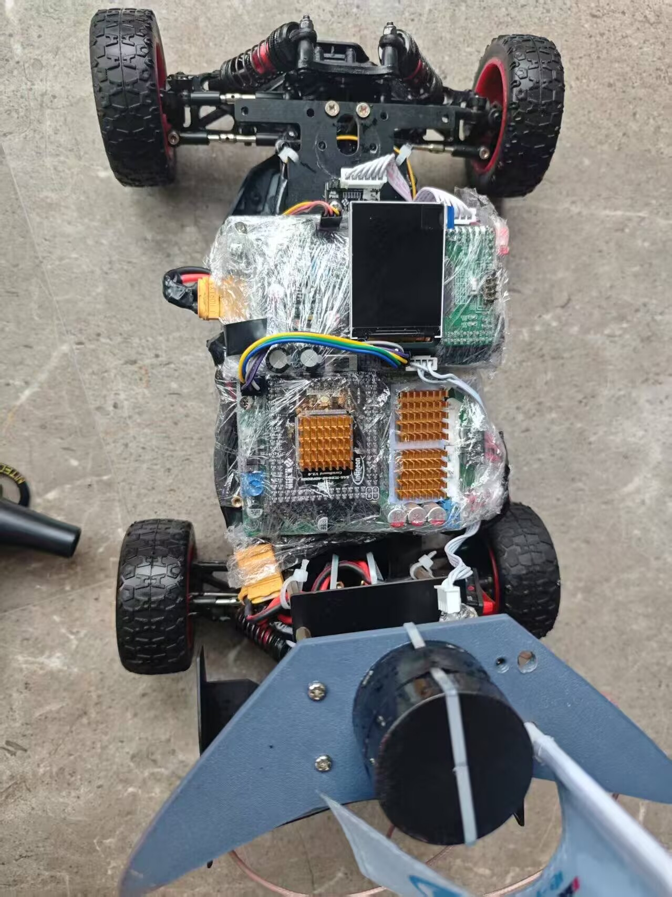
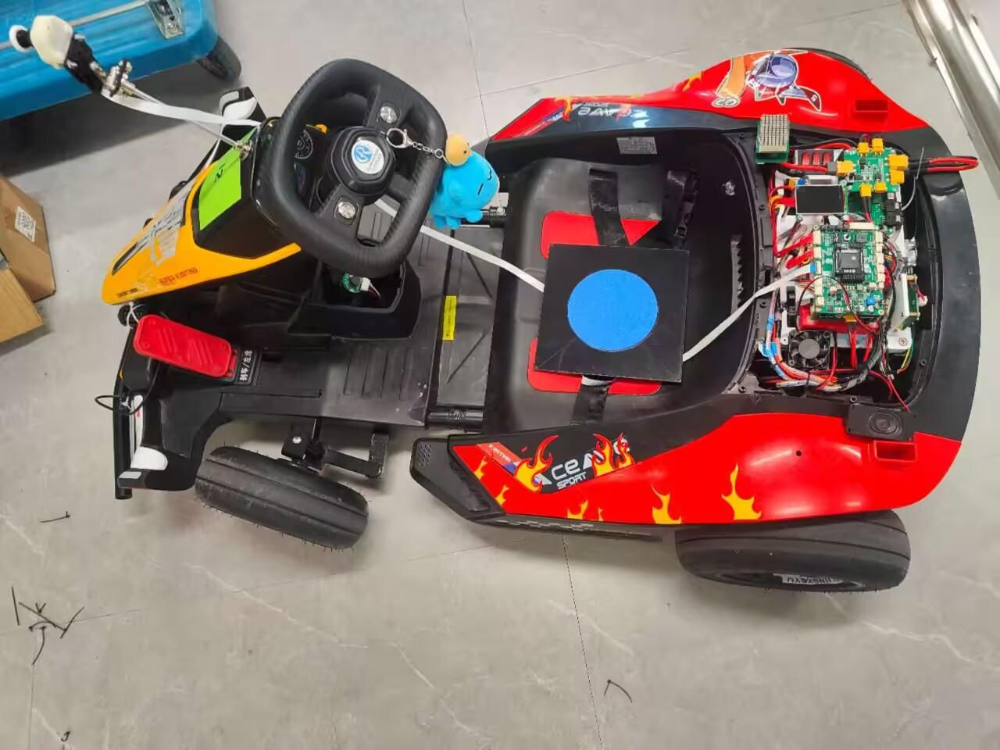

# Project_smartcar

第 20 / 21 届全国大学生智能汽车竞赛（室外组）参赛代码汇总。

- 第 20 届（2025）：**极速越野组**，工程 `Project_20V12`（TC264）
- 第 21 届（2026）：**卡丁快跑组**，工程 `Project` / `Project_21V1` / `Project_21V2`（TC387）
- 第 20 届车模改遥控演示：工程 `project_yk`（TC264D），支持逐飞 **LoRa3A22** 与 **HotRC** 两种遥控链路

开发环境：英飞凌 **ADS（AURIX Development Studio）v1.9.4** + TASKING 编译器
代码底座：逐飞科技 SEEKFREE 开源库（`zf_common` / `zf_driver` / `zf_device`）+ 英飞凌 iLLD
代码规模（不含库）：20V12 约 7.5k 行 / 40 文件；Project 约 7.7k 行 / 44 文件；21V1 约 45k 行 / 84 文件；21V2 约 25.6k 行 / 80 文件；project_yk 约 14.9k 行 / 56 文件（含 20 届模块拷贝）

---

## 一、赛事题目与要求

> 以下内容整理自竞赛组委会（卓晴）公布的第 20 / 21 届规则与科目细则，原文链接见文末【参考资料】。

### 1.1 第 20 届 · 极速越野组

| 项目 | 要求 |
| --- | --- |
| 比赛环境 | 室外操场赛道（跑道、草坪、篮球场、广场等均可部署） |
| 车模 | 四轮越野车模（指定车模平台） |
| MCU 平台 | 英飞凌（本科 / 专科同平台） |
| 允许传感器 | 摄像头、GPS（**不含 RTK**）、惯性导航 |
| 组别属性 | 专科组单独排名 |
| 赛道规模 | 赛道总长按场地条件与队伍数量设定在 **25 m ~ 100 m** |
| 比赛方式 | 分科目并行比赛，每队可跑 1~3 轮取最好成绩 |

**四个比赛科目**

| 科目 | 名称 | 任务与考察点 |
| --- | --- | --- |
| 科目 1 | 往返赛道竞速 | 从发车区出发，经**掉头区域**折返。考察极限速度与加/减速度特性 |
| 科目 2 | 八字型赛道竞速 | 绕行赛道中锥桶后返回，**锥桶间距 ≥ 2 m**。考察转向特性与定位精度 |
| 科目 3 | 特殊路况竞速 | 依次通过：**坡道**（高 20 cm、宽 100 cm、长 150 cm 楔形）、**颠簸路段**（路肩高 2 cm、宽 2.5 cm、间隔约 10 cm）、**人工草坪**、**桥洞**（宽 50 cm、长 200 cm，四角红色锥桶高度 ≥ 50 cm，中心铺 10 cm 宽白色 PVC 或布基胶带）。考察稳定性、安全性与路径通过精度 |
| 科目 4 | 人机语音交互（新增） | 硅麦拾音 → MCU 采集 → WiFi 上传云端 ASR 或本地离线识别 → 文字指令解析 → 灯语 + 动作执行 |

**科目 4 细则要点**

- 硅麦型号限定 **IM68A130A**；灯板必须用英飞凌 **TLD7002**（或 TLD 系列）LED 驱动；WiFi 模块不限，现场不提供网络。
- 语音命令库共 **15 条**：打开双闪灯 / 左转灯 / 右转灯 / 近光灯 / 远光灯 / 雾灯；向前直行 10 m / 后退直行 10 m / 蛇形前进 10 m / 蛇形后退 10 m / 逆时针转一圈 / 顺时针转一圈；停进停车区 1 / 2 / 3。
- 比赛时随机抽 **5 条** = 2 条灯语 + 2 条动作 + 1 条停车区；选手以正常语速连续读完，**10 s 内开始响应、30 s 内按顺序完成**，不得有多余动作；每条灯语显示 **≥ 3 s**。
- 三个停车区并排设置，单个尺寸 **2.5 m × 4 m**，赛前允许 GPS 采点。

**成绩**：三个科目（1~3）时间加权累加；科目 4 作为新增科目按组委会公布的奖励方式计分。

---

### 1.2 第 21 届 · 卡丁快跑组

| 项目 | 要求 |
| --- | --- |
| 比赛环境 | 室外操场赛道 |
| 车模 | 可载人卡丁车模（卡丁 1 / 卡丁 2） |
| MCU 平台 | 英飞凌 **TC2 / TC3 / TC4** 系列（TC212、TC264、TC297、TC364、TC377、TC387 均在允许清单内） |
| 允许传感器 | 摄像头、GPS、IMU、麦克（硅麦） |
| 队伍 | 5 人，专科组单独排名 |
| 通则要点 | 室外组允许 GPS、**不允许 RTK**；电路板统一在嘉立创下单，正面覆铜层印学校 / 队伍 / 年份；新增硬件与软件“盲盒任务”（约 10% 要求现场编程）；零现场裁判、全员办赛 |

**四个比赛科目**

| 科目 | 名称 | 任务与考察点 |
| --- | --- | --- |
| 科目 1 | 自动驾驶 | 从发车区自动出发，按给定方向依次绕行全部锥桶（**锥桶间距 ≥ 3 m**，场地约 ≥ 30 m × 10 m），最后在倒车入库区完成**倒车入库**（门宽 1.5 m、库深 2 m、门口与库底四角锥桶标识） |
| 科目 2 | 战场救护（人车交互） | 硅麦 **IM68A130A** 拾音，两种识别路线：① WiFi 上传云端 ASR；② 离线语音芯片 + 硅麦。四个区域共 35 条语音任务（见下） |
| 科目 3 | 如影随形（穿越迷宫） | ① 第一阶段：人驾或遥控（国赛要求**车模跟随队员**，只能靠机器视觉跟随，禁止携带电子设备引导，允许在引导员衣服贴图案）；② 第二阶段：按第一阶段记忆自动原路返回。成绩 = 两阶段总时间 |
| 科目 4 | 国赛科目（人工智能） | 细则后期公布（与“英飞凌杯”创新挑战赛相关） |

**科目 2 语音任务分区（共 35 条）**

| 区域 | 条数 | 任务内容 |
| --- | --- | --- |
| 发车区 灯光 | 8 | 左转向灯、右转向灯、远光灯、近光灯、雾灯、双闪灯、车内照明灯、雨刷器（雨刷可用灯或舵机模拟；LED 屏需 TLD7002 等英飞凌驱动） |
| 停车区 鸣笛 | 9 | 鸣笛 1/2/3 秒、鸣笛 2/3/4 声、长短鸣笛、急促鸣笛、警报鸣笛（双频 500/1000 Hz 交替）。喇叭要求 **≥2 W 无源扬声器** |
| 行进区 门洞 | 10 | 去程 5 条：门洞 1 左侧 / 门洞 1 / 门洞 2 / 门洞 3 / 门洞 3 右侧；返程 5 条：门洞 1 右侧返回 / 门洞 1 返回 / 门洞 2 返回 / 门洞 3 返回 / 门洞 3 左侧返回（门洞间距 ≥ 1.5 m，场地 ≥ 20 m × 10 m） |
| 动作区 运动 | 8 | 前行 10 m、后退 10 m、蛇形前进 10 m、蛇形后退 10 m、逆时针转一圈、顺时针转一圈、左转、右转（蛇形左右摆幅 > 2 m；转圈半径 3~10 m；左右转需行进 > 2 m 后转向并回正停止） |

---

## 二、工程索引（赛题 ↔ 代码对应）

| 工程 | 主控 | 对应赛事 | 承担科目 | 状态 |
| --- | --- | --- | --- | --- |
| `Project_20V12` | TC264B（tc26xb，BGA292） | 第 20 届 极速越野 | 科目 1、2、3（GPS 打点 + 摄像头循迹） | 可跑；科目 4 语音灯光未实现 |
| `Project` | TC387QP | 第 21 届 卡丁快跑 | 无科目，纯底层驱动验证与模块中转 | 骨架：主循环仅剩编码器测试，其余逻辑被注释 |
| `Project_21V1` | TC387QP | 第 21 届 卡丁快跑（省赛） | 科目 1（导航自动驾驶）、科目 2（35 条语音 + 灯光 + 动作）、科目 3（录点返航） | 省赛版本，功能齐全但冗余多 |
| `Project_21V2` | TC387QP | 第 21 届 卡丁快跑（国赛） | 科目 1（路点/泊车）、科目 2（多核执行灯光鸣笛）、科目 3（视觉跟随 + 记忆返航） | 国赛版本，含 elf/hex 产物 |
| `project_yk` | TC264D（tc26xb，BGA292） | 第 20 届 极速越野（赛后改造） | 无科目：把比赛车改成**手动遥控演示车** | 可跑；LoRa3A22 / HotRC 双链路用宏切换 |

> 备注：`Project` 是 ADS **嵌套工作区**（外层 `Project/` 是 workspace，`.metadata` 内为 Eclipse 工作区缓存），真工程在 `Project/Project/`。

---

## 三、整体代码思路

### 3.1 全工程统一的运行模型

四个工程都沿用逐飞库的标准骨架：**初始化 → 定时器中断分频调度 → 主循环跑业务**。

```text
core0_main()
 ├─ clock_init() / debug_init()          // 时钟、调试串口
 ├─ ALL_init()                            // 业务外设总初始化（见驱动适配层）
 ├─ pit_ms_init(CCU60_CH0, 10)            // 10 ms：PID 更新、按键/菜单扫描
 ├─ pit_ms_init(CCU60_CH1, 1)             // 1  ms：IMU 姿态、蜂鸣器、软延时
 ├─ pit_ms_init(CCU61_CH0, 50/500)        // 50 ms：LED 心跳
 ├─ pit_ms_init(CCU61_CH1, 10)            // 10 ms：INS 航位推算（21 届）
 ├─ cpu_wait_event_ready()                // 等待其他核初始化完成
 └─ while (1)
      ├─ 人机层：菜单 / 语音解析 / 按键 / 显示
      ├─ 决策层：科目状态机（跳点、动作序列、模式切换）
      ├─ 导航层：GPS 解析、INS 更新、路点比较
      └─ 视觉层：取图 → 识别 → 目标误差 → 控制量
```

中断里只做**周期确定**的工作（采样、PID、状态锁存），主循环做**耗时不定**的工作（图像、菜单、语音、Flash），这是四个工程共同的实时性分工。

### 3.2 分层结构

```text
┌───────────────────────────────────────────────┐
│ 应用层  subject.c / Project2.c / navigation.c  │  科目状态机、路点决策、返航
│         menu.c / CI1302.c / Subject_Two.c      │  菜单树、语音指令、灯语动作
├───────────────────────────────────────────────┤
│ 控制层  PID.c / PID_Steer.c / Motor.c          │  速度环、位置环、转向环、差速
│         Angle_Encoder.c / Encoder.c            │  执行器反馈
├───────────────────────────────────────────────┤
│ 感知层  IMU.c / GPS.c / camera.c /             │  姿态、定位、图像
│         Color_discirmination.c / blue_square.c │  色块与圆靶识别
├───────────────────────────────────────────────┤
│ 驱动层  Common_peripheral.c / flash.c / Serial.c│  ALL_init、Flash 路点、串口
│         zf_device_tld7002 / by9301 / NRF24L01   │  灯板、喇叭、无线
├───────────────────────────────────────────────┤
│ 库层    zf_common / zf_driver / zf_device / iLLD│  逐飞库 + 英飞凌底层
└───────────────────────────────────────────────┘
```

### 3.3 第 20 届极速越野的实现路线（`Project_20V12`）

```text
MT9V03X 灰度图(80×60 二值化) → camera.c 八邻域扫线
   ├─ 左右边界 / 中线 / 前瞻 / 曲率
   ├─ 元素识别：直道、十字、左右圆环、坡道、三岔、出入库、断路
   └─ 偏差 → PID_Steer（舵机串级：舵机 PID + 云台 Servo_camera_PID）
后轮：encoder → 速度环 → Pwm_Motor（分段速度表 Speed_km2_Buf[14]）
定位：GPS 经纬度打点 → subject.c Follow_track1/2/3 按 need_distance(2.0 m) 跳点
姿态：IMU660RA 加计 + 陀螺 → quaternion_update → Get_Angle；Karlm.c 做一维卡尔曼与偏航零漂 YawKF
```

- 三个科目用 `flag_go` 切换，`System_Setting_KM1/2/3` 负责参数装载，`Follow_track1/2/3` 负责逐点判定与速度切换。
- 科目 2 提供“max / min”两套速度表；科目 3 提供元素位置选择 `KM3weizixuanze`，用于特殊路况的顺序适配。
- 科目 4（语音灯光）在本工程**未落地**，相关能力在 21 届工程中以 CI1302 + TLD7002 形式实现。

### 3.4 第 21 届卡丁车的实现路线

**（1）`Project`：驱动验证底座**

逐个点亮 21 届要用的执行/感知链路：`All_MOtor_init`、`Angle_Encoder_Init`（前轮绝对角度）、`Encoder_Init`（左右编码器）、`HotRC_control_Init`（SBUS 遥控）、`NRF24L01`、`IMU`（九轴）、`GPS`、`flash`、`path_diagram`，并在 `while(1)` 中留了后轮闭环、发车、科目切换的注释模板。成长记录停在“1 月 10 号电机位置闭环”。

**（2）`Project_21V1`：省赛功能全铺开**

```text
主循环 while(1)
 ├─ GPS_parse() / Auto_control()
 ├─ menu_task()  ←─ 旋钮菜单树：DipSw / KM1-Navi / KM2-Light / KM3-INS / PID
 └─ switch(menu_system_mode)
      ├─ 0 菜单模式：menu_task + INS_choise
      ├─ 1 KM1 导航：INS_choise（GPS 双点误差 + 距离 PID + 分段速度 + 起点航向对齐）
      ├─ 2 KM2 灯光语音：CI1302_process_fifo_data → Project2.c 四阶段状态机（35 条）
      ├─ 3 KM3 惯导：KM3_Record / KM3_Run / 反向路径 / 修点 / 一键返航
      └─ 4 拨码开关模式：dip_switch_mode_task

PIT 10 ms：PID_Controller_Update + LED_Tick
PIT 1 ms ：Get_Angle、key_Scan(15 ms)、Buzzer_scan、Timer_delay_scan
PIT 10 ms：INS_Update（编码器里程 + 陀螺航向 → 二维坐标）
```

- **科目 1（自动驾驶）**：GPS 采点建 `home_run[]`，`GPS_Two_point_error()` 算航向误差、`GPS_Two_point_Distance()` 做距离闭环，按 `Speed_KM1_Buf[]` 分段给速，起步/绕桩/返航由 `next` 索引推进。
- **科目 2（战场救护）**：`CI1302`（UART9，9600）解析 0x01~0x2x 指令；`Project2.c` 把 35 条指令分成 **灯光 8 / 门洞 10 / 动作 8 / 鸣笛 9** 四阶段（`LIGHT_CMDS`/`TRACK_CMDS`/`SPORT_CMDS`/`VOICE_CMDS`）；`Subject_Two.c` 执行双闪、左右转向灯、近远光、雾灯、示廓、雨刮；`zf_device_tld7002.c`（UART4，2 Mbps，16 路 duty）驱动灯板；`by9301.c`（UART10）负责语音播报与喇叭。
- **科目 3（如影随形）**：`KM3_Record` 以 0.5 m 间隔存 `(yaw, dir)` 编码或 `(x, y)` 打包，`Nag_FlashWrite` 存 500 点；`KM3_Run` 逐点插值 `Yaw_Target`；`reverse_path_xy` 反向；`Back_Motor_SetPwm_Diff` 差速辅助转向；`Waypoint_Editor` 用旋钮在现场修点。

**（3）`Project_21V2`：国赛重构（减法 + 视觉 + 多核）**

```text
CPU0：控制主核
 while(1)
  ├─ 三键解锁保护锁
  ├─ blue_square_camera_process()   // SCC8660 取图 → 检测 → 卡尔曼 → PD 追靶
  ├─ System_INS() / INS_choise()    // 纯 INS 航位推算、6 条线路、一键返航
  ├─ CI1302_process_fifo_data()
  └─ 增量邮箱把灯光/鸣笛命令提交给 CPU1
CPU1：灯光/鸣笛执行（mbox_cmd / mbox_ready / mbox_done + __dsync）
CPU3：vofa.c FireWater 遥测（分组分时发送）+ Serial_Data_Resolving 在线调参（m%dx%dy%dz%d）
CPU2：仅初始化，空闲
```

- **科目 3 国赛“视觉跟随”**：`blue_square.c` 用 HSV 阈值找**紫 / 蓝填充圆靶**（默认 `CIRCLE_COLOR_PURPLE`，H 255~330、S ≥ 70、V ≥ 25），输出外接框、中心、`angle_deg`（相对画面中线的像素偏差）与 `distance_mm`；`square_kalman_filter.c` 对角度/距离做卡尔曼平滑；`detect_target` 要求**连续 3 帧确认**才锁定；`blue_square_car_control` 用钳位在 ±937 的**双斜率 PD**（近中线 18，越界后叠加 80，微分 8，±3 px 死区）驱转向，用距离→速度映射（100 mm 停车、800 mm 以上 450 duty）控速，`LOST_TIMEOUT` 丢帧保护时保持转向或停车。
- **科目 1 泊车/返航能力**：`Set_Map_Yaw` 对齐地图航向、`INS_MH`/`INS_MH_Return` 实现定点前进与原路返回、`INS_track_oneway` 单向循迹，配合 GPS/INS 点位完成绕桩后的入库与收车。
- **科目 2 实时性**：语音命令不再在 CPU0 阻塞执行，改为“增量邮箱”只提交新增命令（`last_submit_count` 游标），CPU1 执行完置 `mbox_done`，避免历史命令重放。
- **调试**：`vofa.c` 分 `DEMO/IMU/ENCODER/ANGLE_ENCODER/HOTRC/MOTOR_PID` 六组，按 `telemetry_set_enable` 动态开关；`Color_discirmination.c` 已升级为“HSV 距离图 + 种子膨胀 + 环境光自适应 + 多点学习”，但主函数中 `vision_init()` 仍为注释状态，属备用通道。

### 3.5 遥控演示工程（`project_yk`，20 届车模改遥控）

定位：把 20 届极速越野车模改成**手动遥控演示车**，不跑比赛科目，用于看车、对参数、给观众演示。工程由 `Project_20V12` 复制而来（`camera/imge/Karlm/Servo/subject` 等模块文件创建日期集中在 2025/6/12~7/2），主循环只保留遥控与电压监控；遥控链路通过宏 `LORA3A22_HotRC` 二选一。

```text
core0_main()
 ├─ clock_init / debug_init / ALL_init
 │    ├─ Buzzer / LED / Key / IPS200
 │    ├─ Motor_Init / Steer_Init / All_PID_Init
 │    └─ lora3a22_init()               // UART2，115200
 ├─ adc_init(ADC0_CH11_A11)            // 电池电压，36.3 V 满量程
 ├─ PIT：10 ms 编码器 + 按键；1 ms 蜂鸣器 + 软延时；2 ms 预留
 └─ while (1)
      ├─ 电压采集 + 一阶低通（α = 0.2）+ 屏显
      ├─ 保护锁：key1 一次 + key2 一次累计 3 分解锁
      └─ #if LORA3A22_HotRC
           lora3a22_process_fifo_data → lora3a22_data_show → lora3a22_control
         #else
           HotRC_receive_data_Show → HotRC_control
         （vofa_firewater_send() 可选，把摇杆/开关量推给 VOFA+）
```

**两条遥控链路对比**

| 项 | 逐飞 LoRa3A22（默认，宏 = 1） | HotRC（宏 = 0） |
| --- | --- | --- |
| 物理链路 | UART2，P10_5/P10_6，115200 | SBUS 接收机（`uart_receiver_init()`，6 通道） |
| 帧格式 | 18 字节：帧头 0xA3 + 和校验 + 4 路摇杆(int16) + 4 按键 + 4 拨码 | 标准 SBUS 通道值 |
| 转向 | 左摇杆左右 → `SERVO_MOTOR_MID ± (SERVO_MOTOR_R_MAX − MID)` | channel[0]：中位 824，行程 24~1624 |
| 油门 | 右摇杆前后 → ±档位占空比（量程 +2028 / −1929，线性映射） | channel[1]：中位 1136，行程 497~1936 |
| 档位 | 拨码 `switch_key[1..3]` → 2/3/4 档，占空比 10/15/20/25% | channel[3] 三档：10/15/20% |
| 屏显 | Gear / Spd / Ste / Enc（编码器计数） | 六通道原始值 + 占空比 |

调用约定：`Pwm_Motor()` 入参是 **−100~100 的占空比百分比**，`Steer_Set()` 直接吃舵机 duty（中位 `SERVO_MOTOR_MID`、右满舵 `SERVO_MOTOR_R_MAX`）；两路遥控都先做限幅再线性映射，避免摇杆超量程打满舵机。

### 3.6 关键算法一览

| 模块 | 位置 | 做法 |
| --- | --- | --- |
| 灰度循迹 | `20V12/camera.c` | 二值化 + 八邻域扫线，取左右边界与中线；元素状态机判十字/圆环/坡道/三岔/出入库 |
| 色块检测（HSL 硬阈值） | `21V1/Color_discirmination.c` | RGB565→HSL，阈值内像素做连通域，取外接矩形中心与面积（未接入主循环） |
| 色块检测（软匹配） | `21V2/Color_discirmination.c` | RGB565→LAB/HSV 加权距离图，取最亮点作种子，十字扩展 + 膨胀定中心 |
| 圆靶识别 + 测距 | `21V2/blue_square.c` | HSV 阈值分割 → 连通域筛选 → 外接四边形；距离 = 实径(150 mm) × 焦距(70 px) / 竖直像素直径 |
| 卡尔曼滤波 | `21V2/square_kalman_filter.c`、`20V12/Karlm.c` | 圆靶：角度/距离二维；20 届：一维卡尔曼 + 偏航角与陀螺零漂 YawKF |
| 航位推算（INS） | `21V1/21V2/navigation.c` | 编码器增量 × 轮周长 / PPR + 陀螺航向积分 → (X, Y)；10 ms 更新 |
| GPS 组合导航 | `21V1/navigation.c` | 经纬度转局部 XY、原点设定、`GPS_Correct_INS` / `INS_Correct_GPS` 互补校正、融合权重 `gps_fusion_gain` |
| 路点存储 | `navigation.c` + `flash.c` | 0.5 m 一条，`(x, y)` 以 cm 打包进 int32，最多 500 点；支持反向与标记点 |
| 转向控制 | `PID_Steer.c`、`Angle_Encoder.c`、`blue_square.c` | 舵机/前轮角度闭环；GPS 位置 PID（16.8 / 0.68）；视觉双斜率 PD（±937 限幅） |
| 差速转向 | `Back_Motor_SetPwm_Diff` | 以基准速度 ± 航向误差 × `diff_gain`(0.35) 分配左右轮 PWM |

### 3.7 关键参数

| 参数 | 值 | 位置 |
| --- | --- | --- |
| 编码器每圈脉冲 | 1024 | `PULSE_PER_TURN` / `ENCODER_PPR` |
| 车轮半径 / 周长 | 126 mm / 0.77 m | `WHEEL_RADIUS` / `WHEEL_C` |
| 路点间隔 / 最大点数 | 0.5 m / 500 | `RECORD_DIS` / `NagPoint_MAX` |
| GPS 跳点判定距离 | 2.0 m（科目一）/ 1.5 m | `need_distance` / `need_distance3` |
| 靶标实径 / 焦距 | 150 mm / 70 px | `PURPLE_CIRCLE_REAL_DIAMETER_MM` / `PURPLE_CIRCLE_FOCAL_LENGTH_PX` |
| 视觉转向限幅 | ±937 | `blue_square_car_control` |
| 目标丢失判定 | 30 帧 | `LOST_TIMEOUT` |
| 转向 PID 初值 | Kp 16.8 / Kd 0.68 | `GPS_PID_Init(16.8, 0.68)` |

---

## 四、功能清单

### `Project_20V12`（TC264）

- 摄像头：MT9V03X 初始化、二值化、扫线、元素识别、灰度图显示
- 运动：后轮速度环 PID、舵机 + 云台串级 PID、分段速度表
- 定位：GNSS 解析、经纬度打点、Flash 存取点位、按键改点
- 姿态：IMU660RA 加计/陀螺、四元数姿态、卡尔曼滤波
- 人机：IPS200 屏显、按键、拨码开关选科目、蜂鸣器

### `project_yk`（TC264 · 20 届车模改遥控）

- 遥控：逐飞 LoRa3A22 串口遥控（4 摇杆 / 4 按键 / 4 拨码，18 字节帧 + 和校验）与 HotRC SBUS 六通道，宏 `LORA3A22_HotRC` 切换
- 执行：摇杆 → 电机占空比 / 舵机角度直接线性映射，4 档速度（10/15/20/25%）
- 监控：电池电压 ADC 采集 + 一阶低通 + IPS200 显示；上电保护锁（三键解锁）
- 遥测：`vofa_firewater_send()` 可把遥控全量数据发往 VOFA+
- 遗留：`camera/imu/GPS/flash/path_diagram/subject` 仍编入工程，但 `ALL_init()` 与主循环未调用

### `Project`（TC387）

- 执行：双电机位置/速度环、前转向角度编码器闭环、PWM 输出
- 感知：九轴 IMU、GPS、双编码器（单次/累计/单位时间）
- 通信：HotRC（SBUS）遥控、NRF24L01、调试串口
- 其他：Flash、路径图、滤波、科目框架与发车逻辑模板

### `Project_21V1`（TC387 · 省赛）

- 菜单：旋钮（P11_11 按键 + P13_2/P21_6 编码器）多级菜单、双击/长按、拨码双通道
- 科目 1：GPS 采点、双点航向误差、距离 PID、分段速度、起点对齐
- 科目 2：CI1302 离线语音（35 条四阶段）、TLD7002 灯板、BY9301 喇叭、点阵屏
- 科目 3：INS 录点、Flash 存读、路点插值、反向路径、修点编辑器、一键返航、差速转向
- 其他：DMP 姿态、GPS/INS 互补校正、电压 ADC 均值滤波、路径屏显

### `Project_21V2`（TC387 · 国赛）

- 视觉：SCC8660 圆靶检测、单目测距、卡尔曼、连续帧确认、双斜率 PD、丢帧保护、阈值一键采样
- 导航：纯 INS 航位推算、6 条线路、修点/标记点、画路径、`INS_MH` 前进与返航、摄像头/惯导切换电机源
- 多核：CPU1 灯光/鸣笛增量邮箱、CPU3 VOFA 遥测与串口在线调参
- 科目 2：菜单精简 + 语音指令解析 + 灯光动作执行
- 安全：三键解锁保护锁、转向限幅、速度限幅、目标丢失停车

---

## 五、目录结构

```text
project_smartcar/
├── README.md / README.en.md
├── Project/                    # 21 届驱动验证（ADS 嵌套工作区）
│   ├── .metadata/              # Eclipse 工作区缓存（不建议入库）
│   └── Project/
│       ├── .cproject / .project / Lcf_Tasking_Tricore_Tc.lsl
│       ├── code/               # 业务代码（subject、path_diagram、NRF24L01 ...）
│       ├── libraries/          # 逐飞库 + iLLD(TC38A)
│       ├── user/               # cpu0~cpu3_main.c、isr.c
│       └── Debug/              # 构建产物
├── Project_20V12/              # 20 届极速越野（TC264）
│   ├── code/                   # camera、imge、Karlm、Servo、subject ...
│   ├── libraries/              # 逐飞库 + iLLD(TC26B)
│   ├── user/                   # cpu0/cpu1_main.c、isr.c
│   ├── 推荐IO分配.txt / 尽量不要使用的引脚.txt
│   └── 删除临时文件.bat
├── Project_21V1/               # 21 届省赛
│   ├── code/                   # menu、navigation、Project2、CI1302、TLD7002 ...
│   ├── code/TLD7002_driver/    # 灯板驱动分层实现
│   ├── libraries/ user/
│   └── AURIX修改工程名称.bat
├── Project_21V2/               # 21 届国赛
│   ├── code/                   # blue_square、square_kalman_filter、vofa ...
│   ├── Debug/                  # Project.elf / Project.hex
│   └── libraries/ user/
└── project_yk/                 # 20 届车模改遥控演示（TC264）
    ├── code/                   # HotRC、zf_device_lora3a22、camera、subject ...
    ├── libraries/              # 逐飞库 + iLLD(TC26B)
    └── user/                   # cpu0/cpu1_main.c、isr.c
```

---

## 六、编译与使用

1. **导入**：ADS → `File > Import > Existing Projects into Workspace`，选择目标工程目录（`Project` 请选内层 `Project/Project`）。
2. **刷新**：导入后右键工程 `Refresh`，否则头文件索引可能不全。
3. **编译**：`Project > Build`；TASKING 优化等级默认关闭，可在 `Properties > C/C++ Build > Settings > Compiler > Optimization` 设为 2 级。
4. **烧录/调试**：`Project > Debug As > ...`，经 winIDEA（`.ads/winIDEAWorkspaces`）下载 elf/hex。
5. **串口分配**：按功能各占一路——UART0 调试 / VOFA 遥测、UART1 SCC8660 摄像头、UART3 GNSS、UART4 TLD7002 灯板（2 Mbps）、UART9 CI1302 语音、UART10 BY9301 喇叭、UART2 无线 / SBUS 遥控。具体引脚以各工程 `Common_peripheral.c` 的 `ALL_init()` 与 `zf_device_*.c` 中的 `uart_init(...)` 为准。
6. **接线注意**：`尽量不要使用的引脚.txt` 列出的 P14_2~P14_6、P10_5/P10_6 属 boot 引脚，误用会导致无法启动；推荐 IO 见 `推荐IO分配.txt`——摄像头数据口 P00_0~P00_7（VSY P02_0、PCLK P02_1，HREF 程序不需要故不接）、4 组编码器（33_7/33_6、02_8/00_9、10_3/10_1、20_3/20_0）、8 路 PWM（21_2~21_5、02_4~02_7）、舵机 P33_9、TFT 走 SPI2、ICM20602 走 SPI0（P20_11~P20_14）。
7. **遥控演示工程（`project_yk`）**：在 `user/cpu0_main.c` 顶部改 `#define LORA3A22_HotRC`——`1` 用逐飞 LoRa3A22（UART2，P10_5/P10_6，115200），`0` 用 HotRC SBUS 接收机。上电后先按 key1 一次、key2 一次解锁（合计 3 分）才输出动力，解锁前屏幕只显示电池电压。

---

## 七、已知问题与改进建议

1. **构建产物入库**：`Project/.metadata`（约 100 MB 日志 + 50 MB pdom）、各工程 `Debug/Release`、`.ads/.vs` 应加入 `.gitignore`，否则单次 clone 上百 MB。
2. **注释编码不统一**：多数源文件为 GBK，`Project_21V1/user/cpu0_main.c` 存在 UTF-8/GBK 混存，跨机器打开易乱码；建议统一编码并在 README 注明。
3. **单文件职责过重**：`21V1/navigation.c` 2,504 行同时承载航位推算、Flash、菜单动作、屏显与修点编辑器，建议拆为 `ins_core` / `path_store` / `nav_menu`。
4. **视觉双实现并存**：`21V2` 同时编入 `blue_square.c` 与 `Color_discirmination.c`，后者 `vision_init()` 未启用却保留独立阈值与 `LOST_TIMEOUT`，容易改错对象，建议删除或用 `#if 0` 标注“备用”。
5. **中断负载**：1 ms 中断内执行 `Get_Angle` + 蜂鸣器 + 软延时扫描，10 ms 内执行 PID + 菜单扫描；TC 系列默认不支持中断嵌套（需手动 `interrupt_global_enable(0)`），需关注控制周期抖动。
6. **标定参数分散**：`GPS_PID_Init(16.8, 0.68)`、`need_distance 2.0`、`Speed_km2_Buf[14]`、`WHEEL_RADIUS 126` 等散落各处，建议集中到 `car_config.h`。
7. **跨核经验值得保留**：`21V2/cpu1_main.c` 注释记录了“按索引分区提交导致鸣笛错位、灯光被重放”的踩坑，改为增量邮箱后修复，此类记录建议继续写入各工程 `智能车成长记录.txt`。
8. **`project_yk` 裁剪不彻底**：`camera.c / imge.c / imu.c / GPS.c / flash.c / path_diagram.c / subject.c` 全部编入但主循环不调用，`ALL_init()` 只初始化遥控、电机、舵机与屏；建议用 `#if 0` 圈起或移出工程，减少编译体积与阅读干扰。
9. **`project_yk/code/本文件夹作用.txt` 是 20 届日志的拷贝**：内容与 `Project_20V12` 的成长记录完全一致（2025/2/18~5/27），并非本工程的开发记录；建议改写成“改遥控”的真实过程（2025/6 搭 HotRC 骨架、2026/3 加 LoRa3A22 与电压滤波）。
10. **LoRa 复用 UART2 的 P10_5/P10_6**：这两个脚在工程自带的引脚说明里被列为 boot 引脚，量产板接线前需确认硬件是否已做隔离，必要时换到 UART0/UART1 的空闲脚。

---

## 八、开发时间线（摘自工程内记录）

- **20 届（`Project_20V12/code/本文件夹作用.txt`）**：2025/2/18 点灯 → 3/21 转无刷 → 3/24 舵机 + 陀螺 → 3/25 GPS → 3/30 2.4G 遥控 → 4/18 四元数 → 4/27 Flash 单点循迹 → 5/1 初步完成科目一 → 5/27 换天线。
- **21 届（`Project_21V1/code/智能车成长记录.txt`）**：2025/4/16 导航模块与 IMU/DMP → 6/9 路径图 → 6/12 基础外设与电机 → 6/16 路径处理/WiFi → 2026/1/8 电机 → 3/12 转向 PID 与科目二 → 4/1 语音播报 → 4/15 BY9301 → 4/22 转向角度闭环 → 5/26 科目三录点 → 6/13 IMU 更新 → 7/7 GPS/惯导组合 → 7/9 路径插值返航 → 7/17 出发比赛，7/18 比赛。
- **21 届国赛（`Project_21V2`）**：在 21V1 基础上重构，2026/8/11 引入 VOFA 遥测模块。
- **20 届车模改遥控（`project_yk`）**：模块文件创建日期集中在 2025/6/12~7/2（Motor、Steer、IPS200、GPS、PID、卡尔曼），HotRC 版于 2025/6/15 完成；2026/3/16 加入电池电压一阶低通与 LoRa3A22 遥控链路，形成“LoRa 为主、HotRC 备用”的双链路演示车。

---

## 九、实物图




---

## 十、参考资料

- 第二十届全国大学生智能汽车竞速比赛规则：<https://zhuoqing.blog.csdn.net/article/details/143673441>
- 第 20 届极速越野组新增科目四说明：<https://zhuoqing.blog.csdn.net/article/details/146993089>
- 第二十一届全国大学生智能汽车竞赛比赛规则：<https://zhuoqing.blog.csdn.net/article/details/154598625>
- 第 21 届卡丁快跑组比赛科目细则：<https://zhuoqing.blog.csdn.net/article/details/154697989>
- 逐飞科技库开源网址：<https://gitee.com/seekfree>
- 北京科宇科技库开源网址：<https://gitee.com/beijing-keyu---jiangxi>
- 逐飞科技 TC264 / TC387 开源库说明（`libraries/doc/version.txt`）
